<p align="center">
  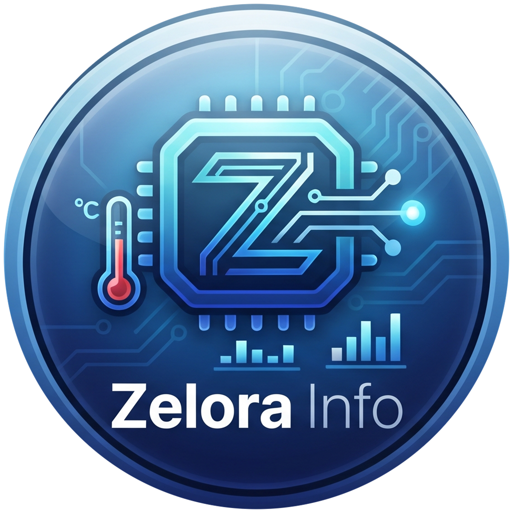
</p>

<h1 align="center">Zelora Info</h1>

<p align="center">
  Disk sağlığı (S.M.A.R.T.), disk benchmark, CPU / RAM ayrıntıları, sistem ve ekran bilgisi — tek, modern bir Windows uygulamasında.<br/>
  <sub>Disk health (S.M.A.R.T.), disk benchmark, CPU / memory details, system and display information — in one modern Windows app.</sub>
</p>

<p align="center">
  
  
  
  
  
</p>

---

## İçindekiler

- [Özellikler](#özellikler)
- [Ekran görüntüleri](#ekran-görüntüleri)
- [Kurulum](#kurulum)
- [Yönetici yetkisi (UAC) ve kısıtlı mod](#yönetici-yetkisi-uac-ve-kısıtlı-mod)
- [Modüller ve veri kaynakları](#modüller-ve-veri-kaynakları)
- [Ayarlar](#ayarlar)
- [Mimari](#mimari)
- [Derleme, test ve release](#derleme-test-ve-release)
- [Lisans ve 3. parti bileşenler](#lisans-ve-3-parti-bileşenler)
- [English summary](#english-summary)

## Özellikler

| Modül | İçerik |
|---|---|
| **Disk Sağlık** | Fiziksel diskler (NVMe, SATA SSD/HDD, USB), sağlık durumu (İyi / Dikkat / Kritik / Bilinmiyor), kalan ömür, sıcaklık (°C/°F), toplam okunan/yazılan, çalışma saati, güç açma sayısı, firmware, arayüz/aktarım modu, seri/model, tam S.M.A.R.T. tablosu (ID, ad, mevcut, en kötü, eşik, ham değer, durum), eşik aşımı ve kritik sıcaklık uyarıları, otomatik yenileme |
| **Disk Benchmark** | Sürücü/klasör seçimi, `SEQ` / `RND` testleri, blok boyutu (4 KiB – 8 MiB), kuyruk derinliği (Q1–Q128), iş parçacığı (T1–T16), test boyutu (16 MiB – 64 GiB), tekrar, ölçüm süresi, canlı ilerleme ve iptal, MB/s + IOPS + ortalama gecikme, panoya kopyalama ve JSON / CSV / TXT dışa aktarma, sistem diski uyarısı, geçici dosyaların her durumda temizlenmesi |
| **Sistem** | İşletim sistemi (ad, özellik güncellemesi, sürüm, yapı, mimari), bilgisayar/kullanıcı adı, çalışma süresi, son yeniden başlatma, UEFI/BIOS ve Güvenli Önyükleme, CPU (model, çekirdek/iş parçacığı, temel/anlık hız, canlı kullanım, önbellek), anakart & BIOS, ekran kartları (sürücü, tam 64-bit VRAM) |
| **CPU Ayrıntı** | CPUID tabanlı kimlik (marka, kod adı, üretim süreci, soket, aile/model/stepping/genişletilmiş değerler, mikrokod), komut setleri (SSE…AVX-512, AVX-VNNI, FMA3, BMI1/2, AES, SHA, VT-x/AMD-V, x86-64, AMX…), hibrit P/E çekirdek sayısı, L1d/L1i/L2/L3 (boyut × adet, ilişkisellik, satır, paylaşım), canlı ortalama/maks frekans, çarpan, mantıksal işlemci başına frekans/kullanım, iptal edilebilir tek/çok çekirdek hızlı CPU testi, TXT/JSON rapor |
| **GPU** | Tüm ekran kartları: model, üretici, tür (harici/tümleşik), mimari, çip, video BIOS, PCI kimliği · VRAM / ayrılmış / paylaşılan bellek · sürücü sürümü (NVIDIA için ör. 621.24), tarihi, sağlayıcı, WDDM sürümü, donanım hızlandırmalı GPU zamanlaması (HAGS) · DirectX 12: özellik seviyesi, Shader Model, DXR, mesh shader, VRS, kaynak bağlama, DirectX 12 Ultimate · PCIe azami / anlık bağlantı · canlı: GPU kullanımı, motor bazında kullanım (3D, Copy, Video Decode/Encode…), VRAM ve paylaşılan bellek kullanımı, sıcaklık, fan, güç, çekirdek ve bellek frekansı (sürücü bildiriyorsa) · TXT/JSON rapor |
| **RAM › Genel bakış** | Toplam/kullanılan/boş bellek, canlı kullanım %, commit, DIMM modülleri (kapasite, MT/s, DDR tipi, form faktör, üretici, parça no, seri, voltaj), slot sayısı ve azami kapasite, sayfa dosyası |
| **RAM › Bellek Haritası** (RAMMap benzeri) | Fiziksel bellek dağılımı (Kullanımda / Değiştirilmiş / Beklemede / Boş / Donanıma ayrılmış), sayfa listeleri (sıfırlanmış, boş, değiştirilmiş, yazılmayacak, bekleme, hatalı), bekleme listesi öncelikleri (yönetici modunda 0–7 + yeniden kullanım sayıları, aksi halde Reserve/Normal/Core grupları), etkin tüketiciler (işlem özel çalışma kümeleri, sistem önbelleği, sayfalı/sayfasız havuz, sürücüler, çekirdek kodu), commit ve sayılar, aranabilir/sıralanabilir işlem tablosu (çalışma kümesi, özel/paylaşılan ÇK, özel bayt, havuzlar, sayfa hatası), fiziksel bellek aralıkları, RAMMap "Empty" komutları (yönetici; onaylı) · TXT/JSON rapor |
| **RAM › Ayrıntı / SPD** | Ham SMBIOS (tip 16/17) ile boş slotlar dahil tüm slotlar, bellek tipi, kanal modu (Single/Dual/Quad… — slot etiketlerinden çıkarım), DRAM frekansı ve etkin MT/s, ECC, rank, veri/toplam genişlik, min/maks/yapılandırılmış voltaj (VDD), zamanlamalar bölümü (bkz. [sınırlamalar](#sınırlamalar)), seri numarası maskeleme, TXT/JSON rapor |
| **Ekran** | Tüm monitörler, birincil ekran, aktif ve önerilen (yerel) çözünürlük, yenileme hızı ve azami Hz, DPI / ölçekleme %, renk derinliği ve bit/kanal, HDR (destek/durum), fiziksel boyut ve diyagonal, en-boy oranı, yönlendirme, bağlantı tipi (HDMI/DP/eDP…), sanal masaüstü ve çalışma alanı koordinatları |
| **Ayarlar** | Uygulamanın tüm seçenekleri tek ekranda: 6 dil, 5 tema + Windows'u izle, arayüz ölçeği, açılış sayfası, kapat (X) davranışı, tepsiye küçültme, Windows ile başlatma, her açılışta yönetici izni, S.M.A.R.T. yenileme/eşikler/birim, canlı yenileme aralığı, seri maskeleme, benchmark varsayılanları, geçici dosya temizliği, varsayılana sıfırlama |
| **Hakkında** | Üç sekme: **Genel bakış** (sürüm/derleme/çalışma zamanı, Şero Teknoloji, Apache 2.0 özeti, 3. parti bileşen listesi) · **Apache 2.0 Lisansı** (tam metin, kopyala / .txt kaydet) · **3. Parti Lisanslar** (arama, ayrıntı, tam lisans metni, kopyalama) |

Ek olarak:

- **6 dil**, anında geçiş: Türkçe, English, Deutsch, Français, Italiano, Español.
- **5 tema**: Gece Yarısı (koyu, varsayılan), Grafit (OLED siyah), Aurora (koyu mor), Gündüz (açık), Kum (sıcak açık) + *Windows'u izle*.
- **Sistem tepsisi**: Kapat (X) butonunda "Tepsiye küçült / Uygulamayı kapat" sorusu (seçimi hatırlama seçeneğiyle); tepsi ikonunun sağ tık menüsünden tüm sekmelere doğrudan erişim.
- **Tek örnek**: Uygulama tepsideyken yeniden çalıştırılırsa mevcut pencere öne gelir.

## Ekran görüntüleri

| Disk Benchmark | CPU Ayrıntı |
|---|---|
| 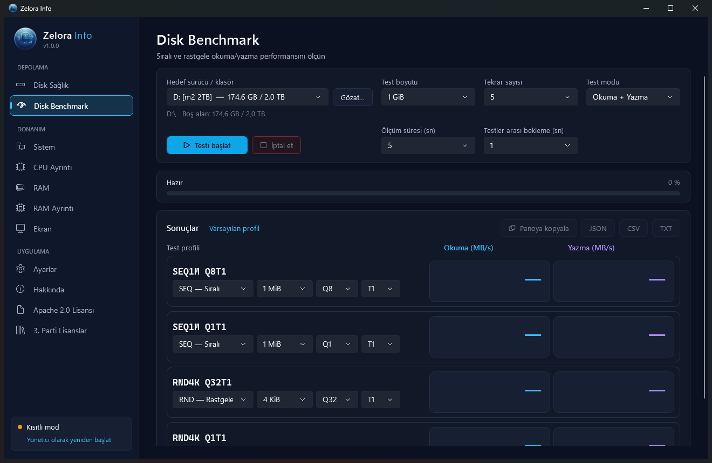 | 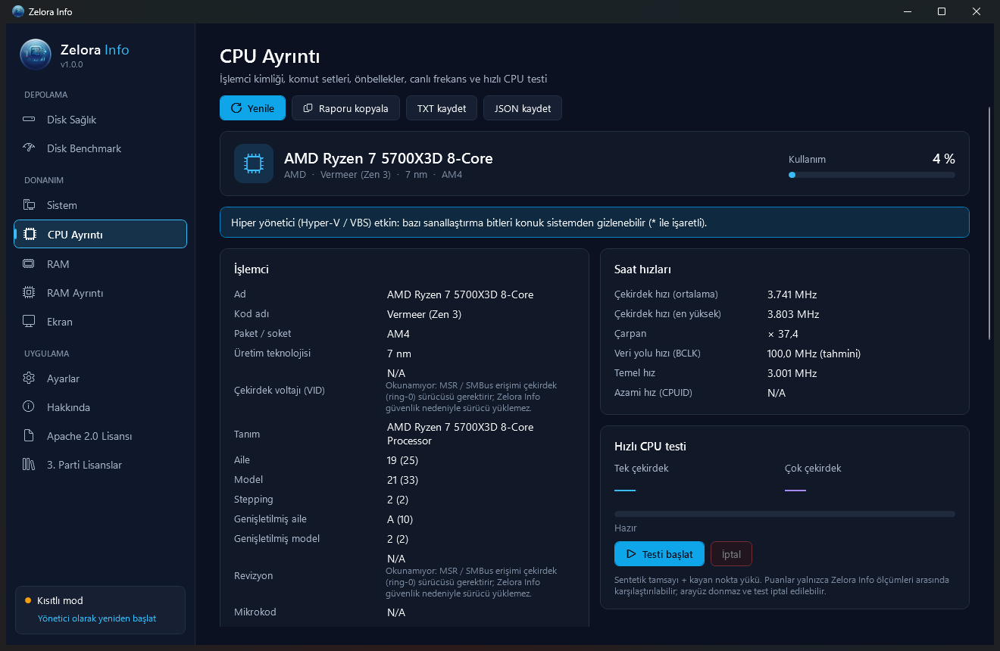 |

| GPU |
|---|
| 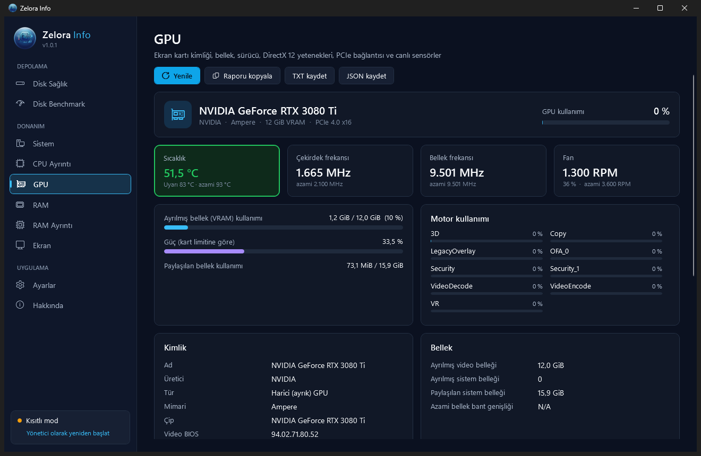 |

| RAM › Bellek Haritası | Ekran |
|---|---|
| 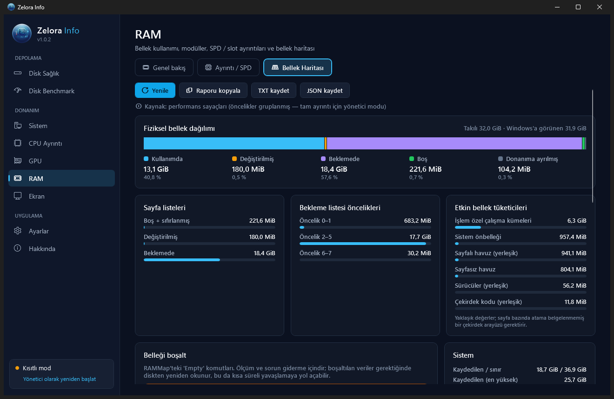 | 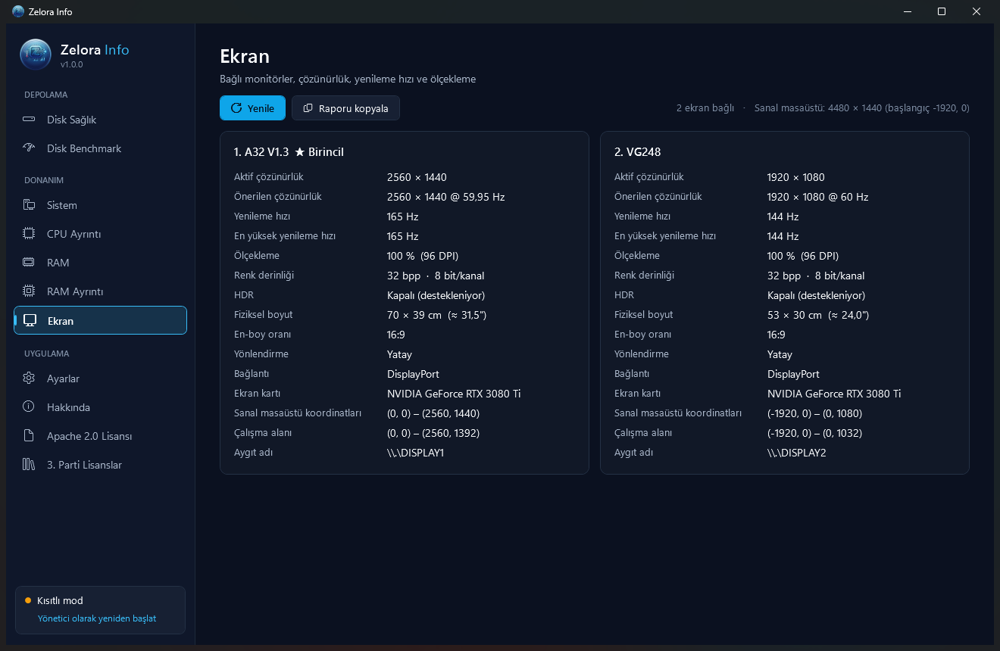 |

| Ayarlar — temalar (Aurora, English) | Gündüz teması |
|---|---|
| 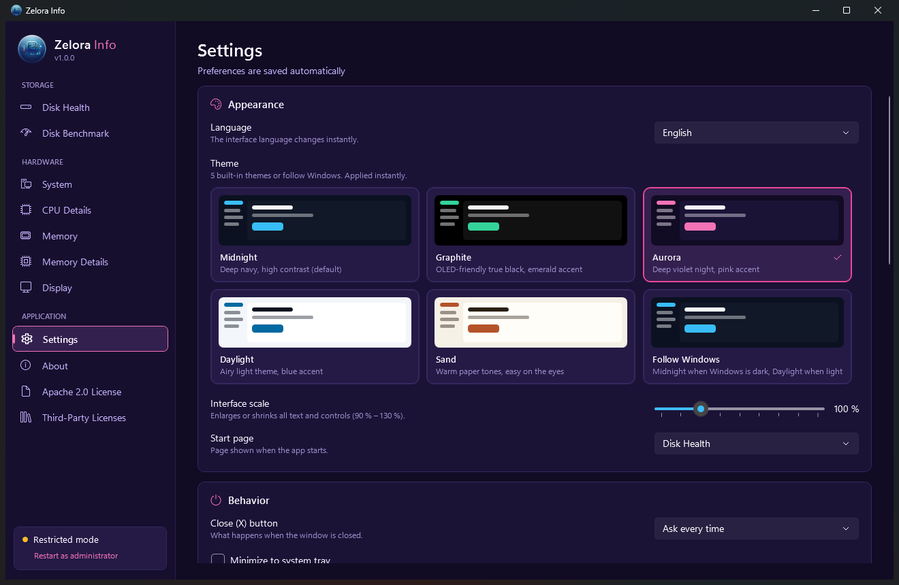 | 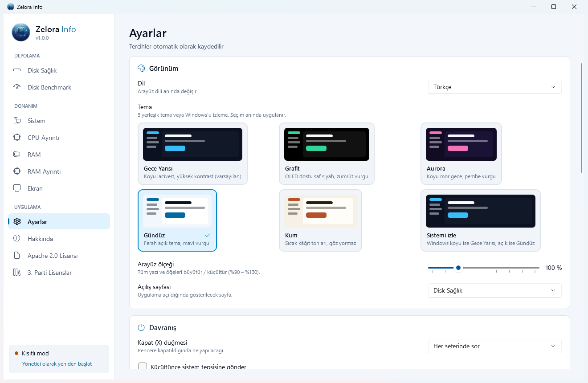 |

| Hakkında › Genel bakış | Hakkında › 3. Parti Lisanslar |
|---|---|
| 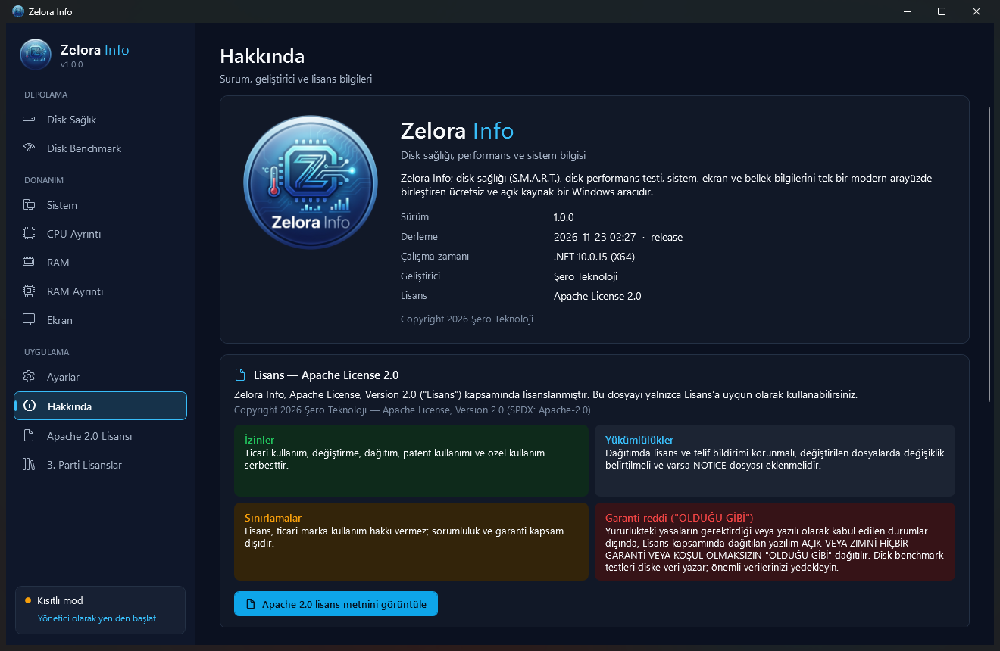 | 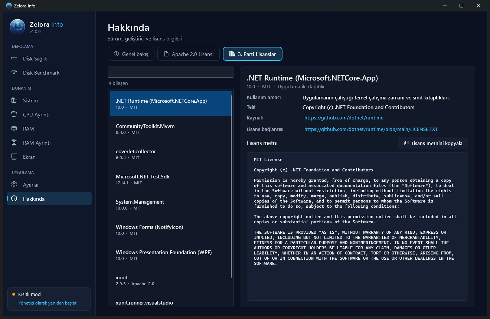 |

| Kapatma penceresi |
|---|
| 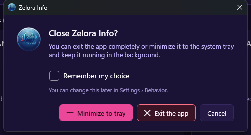 |

## Kurulum

[Releases](../../releases) sayfasından paket indirin:

| Paket | Açıklama |
|---|---|
| `ZeloraInfo-<sürüm>-win-x64.zip` | **Önerilen.** Kendi kendine yeten tek `ZeloraInfo.exe` — .NET kurulumu gerekmez. |
| `ZeloraInfo-<sürüm>-win-x64-framework.zip` | Küçük boyutlu; [.NET 10 Desktop Runtime (x64)](https://dotnet.microsoft.com/download/dotnet/10.0) gerektirir. |
| `SHA256SUMS.txt` | Paketlerin SHA-256 özetleri. |

1. Zip'i bir klasöre çıkarın (ör. `C:\Programs\ZeloraInfo`).
2. `ZeloraInfo.exe` dosyasını çalıştırın. Kurulum veya kayıt defteri değişikliği gerekmez (taşınabilir).
3. Windows SmartScreen uyarı verirse **Ek bilgi › Yine de çalıştır** seçin (uygulama kod imzalı değildir).

**Sistem gereksinimleri:** Windows 10 (1809+) veya Windows 11, x64.

**Kaldırma:** Klasörü silin. Ayarlar `%APPDATA%\ZeloraInfo\settings.json`, hata günlüğü `%LOCALAPPDATA%\ZeloraInfo\logs\` altındadır. "Windows ile başlat" açıksa önce Ayarlar'dan kapatın.

## Yönetici yetkisi (UAC) ve kısıtlı mod

Uygulama **yönetici izni istemeden** (`asInvoker`) açılır ve gerekmeyen hiçbir işlem için UAC sormaz.

| Özellik | Yönetici gerekir mi? | Yetki yoksa |
|---|---|---|
| Disk listesi, model, kapasite, Windows sağlık durumu | Hayır | — |
| S.M.A.R.T. öznitelikleri, sıcaklık, çalışma saati, okunan/yazılan (ATA & NVMe) | **Evet** | **Kısıtlı mod:** sarı uyarı + "Yönetici olarak yeniden başlat" butonu; değerler "—" ve nedeni gösterilir |
| Disk benchmark | Hayır (hedef klasöre yazma izni yeterli) | — |
| Sistem, Ekran, RAM (Genel bakış, Ayrıntı / SPD, Bellek Haritası), CPU Ayrıntı, GPU (sensörler dahil) | Hayır | Bellek Haritası öncelikleri gruplanmış gösterir |
| Bellek Haritası: 8 bekleme önceliği, sıfırlanmış/boş ayrımı, "Empty" komutları | **Evet** | Performans sayaçlarıyla gruplanmış görünüm; boşaltma butonları devre dışı |

- Kenar çubuğundaki durum kutusu (**Yönetici modu / Kısıtlı mod**) yetkiyi her zaman gösterir.
- **Ayarlar › Davranış › Her açılışta yönetici izni iste** seçeneğiyle uygulama her başlangıçta UAC ister; reddedilirse kısıtlı modda çalışmaya devam eder.

### Sınırlamalar

Zelora Info **çekirdek (ring-0) sürücüsü yüklemez**. Bu nedenle yalnızca SMBus/SPD EEPROM'u veya MSR yazmaçlarıyla okunabilen değerler **uydurulmaz**, `N/A` ve nedeniyle gösterilir:

- Bellek zamanlamaları (tCL, tRCD, tRP, tRAS, CR, tRFC), VDDQ, XMP/EXPO profilleri
- CPU çekirdek voltajı (VID), AMD'de gerçek BCLK (100 MHz varsayılır ve "tahmini" olarak işaretlenir), NB/uncore frekansı
- USB köprüleri üzerinden S.M.A.R.T. (SAT geçişi) — köprü desteklemiyorsa "USB köprüsü desteklemiyor" gösterilir
- DRAM voltajı (VDD) SMBIOS'tan okunur.

## Modüller ve veri kaynakları

| Modül | Kaynak |
|---|---|
| Disk listesi | `root\Microsoft\Windows\Storage` → `MSFT_PhysicalDisk`, `MSFT_Partition` (yedek: `Win32_DiskDrive`) |
| ATA S.M.A.R.T. | `SMART_RCV_DRIVE_DATA` (READ DATA `D0h`, READ THRESHOLDS `D1h`, IDENTIFY `ECh` → SATA hızı, dönüş hızı) |
| NVMe sağlık | `IOCTL_STORAGE_QUERY_PROPERTY` / `StorageDeviceProtocolSpecificProperty` → log sayfası `02h` |
| Yedek sayaçlar | `MSFT_StorageReliabilityCounter` |
| Benchmark | `FILE_FLAG_NO_BUFFERING` + `WRITE_THROUGH`, örtüşen G/Ç (IOCP), sayfa hizalı bellek, sıkıştırılamaz rastgele veri; her test için en iyi tur raporlanır (MB/s = 10⁶ B/s) |
| Sistem | WMI (`Win32_OperatingSystem`, `Win32_Processor`, `Win32_BaseBoard`, `Win32_BIOS`, `Win32_VideoController`), kayıt defteri (`DisplayVersion`, `UBR`, GPU `qwMemorySize`, Secure Boot), `GetFirmwareType`, PDH (`% Processor Utility`, `% Processor Performance`) |
| CPU Ayrıntı | `X86Base.CpuId` (CPUID 0, 1, 7, 7.1, 16h, 8000000xh), `GetLogicalProcessorInformationEx`, PDH mantıksal işlemci sayaçları, `CentralProcessor\0` mikrokod |
| GPU | DXGI (`CreateDXGIFactory1`, `IDXGIAdapter1::GetDesc1`), D3D12 (`D3D12CreateDevice`, `CheckFeatureSupport`), WDDM çekirdek arayüzü `D3DKMTQueryAdapterInfo` (WDDM sürümü, HAGS, mimari/BIOS, sıcaklık, fan, güç, frekanslar — Görev Yöneticisi ile aynı kaynak), PDH `GPU Engine` / `GPU Adapter Memory`, sürücü sınıf anahtarı (kayıt defteri), `CM_Get_DevNode_Property` (PCIe bağlantı hızı/genişliği) |
| Bellek Haritası | `NtQuerySystemInformation` (SystemMemoryListInformation — yönetici, SystemProcessInformation), `\Memory\*` PDH sayaçları, `GetPerformanceInfo`, `GetPhysicallyInstalledSystemMemory`, `HKLM\HARDWARE\RESOURCEMAP\…\Physical Memory` (REG_RESOURCE_LIST), boşaltma: `NtSetSystemInformation` (MemoryEmptyWorkingSets / FlushModifiedList / PurgeStandbyList / PurgeLowPriorityStandbyList) ve `SetSystemFileCacheSize(-1, -1)`; RAMMap'in sayfa bazında görünümleri (Use Counts, Physical Pages, File Summary) belgelenmemiş Superfetch sorgusu gerektirdiği için yoktur |
| RAM / Ayrıntı / SPD | `GlobalMemoryStatusEx`, ham SMBIOS (`GetSystemFirmwareTable('RSMB')`, tip 16/17), `Win32_PhysicalMemory`, `Win32_PageFileUsage` |
| Ekran | `EnumDisplayMonitors`, `EnumDisplaySettings`, `GetDpiForMonitor`, DisplayConfig API (ad, bağlantı, önerilen mod, HDR), `WmiMonitorBasicDisplayParams` |

## Ayarlar

Tüm ayarlar **Ayarlar** ekranından yönetilir, anında uygulanır ve `%APPDATA%\ZeloraInfo\settings.json` dosyasına okunabilir JSON olarak kaydedilir (atomik yazma; bozuk dosya yedeklenip varsayılanlarla devam edilir).

| Bölüm | Seçenekler |
|---|---|
| Görünüm | Dil (6), tema (5 + Windows'u izle), arayüz ölçeği %90–130, açılış sayfası |
| Davranış | Kapat (X): her seferinde sor / tepsiye küçült / kapat · küçültünce tepsiye gönder · Windows ile başlat (`HKCU\…\Run`) · küçültülmüş başlat · her açılışta yönetici izni |
| Disk Sağlık | Yenileme sıklığı (kapalı…30 dk), sıcaklık birimi, dikkat/kritik sıcaklık, yeniden atanmış sektörlerde "Dikkat" |
| Donanım izleme | Canlı yenileme aralığı (250 ms – 10 s), CPU testi süresi, seri numarası maskeleme |
| Benchmark | Test boyutu, tekrar, süre, bekleme, mod; test sonrası dosyayı sil, açılışta artık dosyaları temizle, sistem diski uyarısı, şimdi temizle |
| Bakım | Ayar dosyası konumu, klasörü aç, varsayılanlara sıfırla |

## Mimari

```
ZeloraInfo.slnx
├─ src/
│  ├─ ZeloraInfo.Core            # Modeller, servis arayüzleri, S.M.A.R.T. sağlık mantığı, biçimlendiriciler,
│  │                             # dil kataloğu (TR/EN/DE + FR/IT/ES), lisans manifesti modeli — saf .NET, testlenebilir
│  ├─ ZeloraInfo.Infrastructure  # Donanım sağlayıcıları: WMI, DeviceIoControl, CPUID, SMBIOS, PDH, DisplayConfig,
│  │                             # benchmark motoru, JSON ayar servisi, UAC / başlangıç kaydı
│  └─ ZeloraInfo.App             # WPF (Fluent ThemeMode) + MVVM (CommunityToolkit.Mvvm): görünümler, view-model'ler,
│                                # tema/dil yöneticileri, sistem tepsisi, kapatma penceresi
├─ tests/ZeloraInfo.Tests        # xUnit: dil kataloğu, ayarlar, ayrıştırıcılar, sağlık, benchmark, manifest…
├─ tools/                        # Build-Release.ps1, Update-ThirdPartyLicenses.ps1
├─ docs/images/                  # logo, ekran görüntüleri, logo kaynak görselleri
├─ LICENSE · NOTICE · third-party-licenses.json
```

- **Asenkron & iptal:** Tüm taramalar ve testler `Task` + `CancellationToken` ile UI dışı çalışır; ilerleme `IProgress<T>` ile bildirilir.
- **i18n:** `LanguageCatalog` her anahtar için 6 çeviriyi bir arada tutar; WPF tarafında `{DynamicResource Anahtar}` ile anında dil değişimi. Testler eksik çeviri ve `{0}` yer tutucu uyumsuzluğunu yakalar.
- **Tema:** WPF Fluent (`Application.ThemeMode`) + değiştirilebilir `Palette.<Tema>.xaml` sözlükleri; başlık çubuğu DWM ile koyu/açık.
- **Hata yönetimi:** Tekil disk/WMI hataları uygulamayı düşürmez; beklenmeyen hatalar kullanıcıya gösterilir ve `%LOCALAPPDATA%\ZeloraInfo\logs\error.log` dosyasına yazılır.

## Derleme, test ve release

Gereksinim: .NET 10 SDK (veya daha yeni, `net10.0-windows` hedefler).

```powershell
dotnet build ZeloraInfo.slnx
```
```powershell
dotnet test ZeloraInfo.slnx
```
```powershell
dotnet run --project src/ZeloraInfo.App
```

Release paketleri (testler + self-contained ve framework-dependent zip + SHA256) `release/` klasörüne üretilir:

```powershell
powershell -ExecutionPolicy Bypass -File .\tools\Build-Release.ps1
```

## Lisans ve 3. parti bileşenler

```
Copyright 2026 Şero Teknoloji

Licensed under the Apache License, Version 2.0 (the "License");
you may not use this software except in compliance with the License.
You may obtain a copy of the License at http://www.apache.org/licenses/LICENSE-2.0
```

Tam metin: [LICENSE](LICENSE) (uygulamada **Hakkında › Apache 2.0 Lisansı** sekmesi). Atıf bildirimleri: [NOTICE](NOTICE).

3. parti bileşenler [`third-party-licenses.json`](third-party-licenses.json) manifestinde tutulur ve uygulamadaki **Hakkında › 3. Parti Lisanslar** sekmesinde aranabilir şekilde, tam lisans metinleriyle gösterilir:

| Bileşen | Sürüm | Lisans | Kapsam |
|---|---|---|---|
| .NET Runtime, WPF, Windows Forms | 10.0 | MIT | Uygulamayla dağıtılır |
| CommunityToolkit.Mvvm | 8.4.0 | MIT | Uygulamayla dağıtılır |
| System.Management | 10.0.0 | MIT | Uygulamayla dağıtılır |
| xunit, xunit.runner.visualstudio | 2.9.3 / 3.1.4 | Apache-2.0 | Yalnız test |
| Microsoft.NET.Test.Sdk, coverlet.collector | 17.14.1 / 6.0.4 | MIT | Yalnız test |

**Bağımlılık eklerken/güncellerken:** `tools/Update-ThirdPartyLicenses.ps1` içindeki tabloyu düzenleyip çalıştırın. `ThirdPartyManifestTests` testi, herhangi bir `PackageReference` manifestte yoksa veya sürümü farklıysa derlemeyi kırar.

> "CrystalDiskInfo", "CrystalDiskMark", "CPU-Z" ve "RAM-Z" ilgili sahiplerinin bağımsız ürünleridir. Zelora Info bu ürünlerle bağlantılı değildir ve onların kodunu içermez.

---

## English summary

**Zelora Info** is a free, open-source (Apache-2.0) Windows 10/11 utility by **Şero Teknoloji** that combines:

- **Disk Health** — S.M.A.R.T. for ATA/SATA and NVMe (health, life, temperature, host reads/writes, power-on hours/count, full attribute table, threshold & temperature alerts).
- **Disk Benchmark** — CrystalDiskMark-style SEQ/RND tests with configurable block size, queue depth, threads, size and iterations; unbuffered overlapped I/O; MB/s, IOPS, latency; cancel anytime; JSON/CSV/TXT export; guaranteed temp-file cleanup.
- **System, Display, Memory** — OS, CPU, board, BIOS/UEFI, GPU; every monitor's resolution, refresh rate, DPI, HDR, size, connection; RAM usage, DIMMs and page file.
- **GPU** — GPU-Z style view: identity, architecture, VBIOS, VRAM, driver / WDDM / HAGS, DirectX 12 feature level, shader model, DXR, mesh shaders, VRS, PCIe link, plus live utilization per engine, VRAM usage, temperature, fan, power and clocks (via the WDDM kernel interface, no driver needed).
- **Memory Map** (RAM page tab, RAMMap style) — physical memory composition, page lists, standby priorities, active consumers, per-process working sets, physical ranges and RAMMap's "Empty" commands (admin).
- **CPU Details / Memory Details** — CPUID identity, code name, instruction sets, hybrid cores, cache hierarchy, live per-core clocks, quick CPU score; SMBIOS slot/SPD view incl. empty slots, channel mode, rank, voltages. Values that would require a kernel driver (DRAM timings, XMP/EXPO, VID) are shown as N/A — never guessed.
- **6 languages** (TR/EN/DE/FR/IT/ES), **5 themes** + follow Windows, system tray with page shortcuts, close-to-tray prompt, single instance, all options managed from **Settings**.

Runs unelevated by default; S.M.A.R.T. needs administrator rights (one-click *Restart as administrator*, or *Request administrator rights on every start*).
